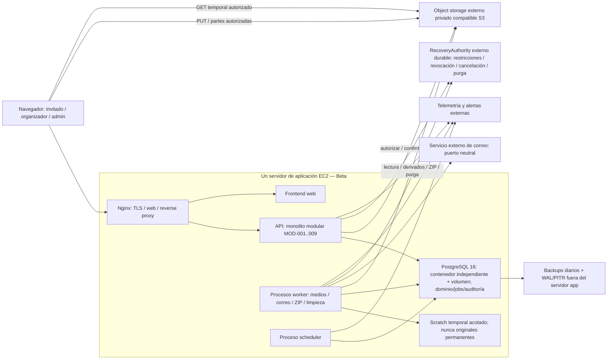

# EventLens — arquitectura inicial

Fecha: 2026-10-07. Diseño documental, todavía sin implementación ni pruebas de capacidad. **CONFIRMED:** restricciones de [DEC-061..064](../product/DECISIONS.md) y [CR-002](../product/changes/CR-002.md). **RECOMMENDED:** decisiones de diseño de [architecture-decisions.md](architecture-decisions.md), sujetas al quality gate. Las recomendaciones no agregan respuestas a PL-001..014 ni sustituyen decisiones aceptadas.

## Componentes y despliegue

| Componente | Relación con aplicación | Ubicación MVP | Evolución permitida |
|---|---|---|---|
| Frontend + API | Un producto y release coordinado; capas separadas, API modular | Mismo servidor; modalidad de entrega frontend por definir dentro del baseline aprobado | Hosting frontend/API independientes manteniendo contratos |
| Nginx | Adaptador de entrada; TLS, cabeceras, reverse proxy, límites pequeños de request | Mismo servidor, configuración versionada | Reverse proxy/balanceador externo si la operación lo requiere |
| PostgreSQL y cola SQL | Una DB inicial; ownership lógico por módulo y tablas de jobs separadas | **CONFIRMED — DEC-106:** contenedor independiente en el mismo servidor durante Beta, con volumen persistente | Escalar DB; separar cola mediante JobQueue solo con evidencia |
| Object storage | Adaptador ObjectStorage; objetos privados | **CONFIRMED:** externo para Beta; MinIO local con volumen sólo para desarrollo/validación (EL-TD-008) | Cambiar adaptador/proveedor; CDN privada opcional |
| Workers + scheduler | Mismo código modular, entrypoints/procesos distintos | **RECOMMENDED:** mismo compute inicial con presupuestos de recursos y supervisión independientes | Otros servidores/procesos y múltiples consumidores sin cambiar casos de uso |
| Procesamiento multimedia | Handlers de MOD-003 + adaptadores de inspección/conversión | Worker aislado; scratch efímero y limitado | Workers especializados con códecs y capacidad dedicados |
| Exports ZIP | Handlers de MOD-005; streaming y multipart hacia storage | Proceso worker con concurrencia acotada | Pool independiente si compite por I/O/CPU |
| Correo | MOD-009 + EmailGateway; envío mediante job | Servicio externo, worker local; proveedor no seleccionado | Cambiar adaptador sin dominio específico de proveedor |
| Observabilidad | Instrumentación compartida, operación MOD-009 | Métricas/logs exportados; monitor externo imprescindible | Backend de telemetría distinto sin modificar dominio |
| Backups/PITR | Infraestructura y procedimientos, no una función del proceso web | Backup/WAL externos y recuperación DB verificable | Proveedor/herramienta elegidos después por cumplimiento |
| RecoveryAuthority | Puerto operacional compartido; los dominios poseen hechos de seguridad/privacidad | Fuera de la línea PITR DB; checkpoint/ACK + barrier fail-closed | Adapter neutral; no restablecer permiso desde snapshot sin reconciliación |

Docker Compose es la orquestación inicial **ACCEPTED** según [EL-TD-008](technical-baseline.md#el-td-008--local-environment-and-beta-topology). Durante Beta PostgreSQL comparte servidor con app como contenedor independiente; recursos/health checks/aislamiento y recuperación son obligatorios. App y DB comparten riesgo de pérdida del host: backups/WAL protegidos fuera de éste y restore probado siguen siendo necesarios. MinIO local no selecciona storage Beta. API, workers y scheduler continúan separados; se conservan límites de CPU/memoria/PIDs/tiempo/scratch y margen operacional.

## Límites y contratos

Los nueve módulos funcionales siguen siendo límites del monolito; no son nueve servicios. [domain-map.md](domain-map.md) identifica ownership y contratos. [backend-architecture.md](backend-architecture.md) define transacciones, dependencias y capacidades compartidas. Lenguajes y frameworks están aprobados en [technical-baseline.md](technical-baseline.md). Versiones, tipo EC2 y proveedores DB/storage/correo requieren selección técnica localizada y validación cuando sean necesarios, sin replantear la topología confirmada ni resolver decisiones DEFERRED silenciosamente.

La API controla quién puede hacer qué; almacenamiento ejecuta operaciones privadas, sin conocer permisos de producto. Jobs transportan referencias pequeñas; workers ejecutan los mismos casos de uso y políticas actuales, no una segunda implementación de reglas. Scheduler descubre trabajo vencido; no decide estados usando reglas duplicadas.

## Invariantes principales

- Original confirmado es inmutable; derivados y exports jamás lo reemplazan.
- DB gobierna permisos y estados funcionales; existencia física se verifica mediante ObjectStorage. Ninguno implica automáticamente el otro.
- Cambios funcionales y enqueue SQL se confirman juntos; efectos externos se reconcilian, sin prometer transacción distribuida.
- Ejecución al menos una vez con deduplicación, lease y fencing; todo resultado se valida contra generación vigente del recurso.
- Acceso nuevo se deniega ante cierre, purga, bloqueo o pérdida de autorización. URLs ya emitidas tienen limitación de revocación explícita.
- Restore verifica journal externo de revocaciones/restricciones/borrado cancelable y epoch para account/admin/guest/reset tokens/QR/PIN; snapshot nunca revive privilegio antiguo.
- Portada es EventAsset de configuración owner autorizado, pipeline físico MOD-003 y asignación MOD-002; no se abre carga invitada en DRAFT.
- `DELETED` significa purga del almacenamiento activo verificada y sin escritor autorizado pendiente; backups rotan según política y no habilitan restauración normal.

## Guía de lectura y preparación

[media-and-jobs-architecture.md](media-and-jobs-architecture.md): carga, estado físico, procesamiento, cola, workers, scheduler, entrega privada y ZIP. [operations-and-recovery.md](operations-and-recovery.md): purga, PITR, capacidad, observabilidad y matriz de fallos. [testing-strategy.md](testing-strategy.md): evidencia requerida antes de operar Beta.

**PENDING quality gate:** correcciones AQR-001..004 documentadas para re-review independiente; no se autocertifica `READY_FOR_TICKETS`. Aunque el diseño estructural se apruebe, PL-001..014 bloquean las capacidades funcionales afectadas, y Q-029 bloquea apertura pública. No se han generado tickets.

## Technical Baseline

EventLens Beta uses:

- Angular + TypeScript for the web application.
- NestJS + TypeScript for the backend.
- PostgreSQL with Prisma.
- REST + JSON with OpenAPI.
- pnpm workspaces monorepo.
- Vitest and Playwright.

See `technical-baseline.md` for authoritative details.
