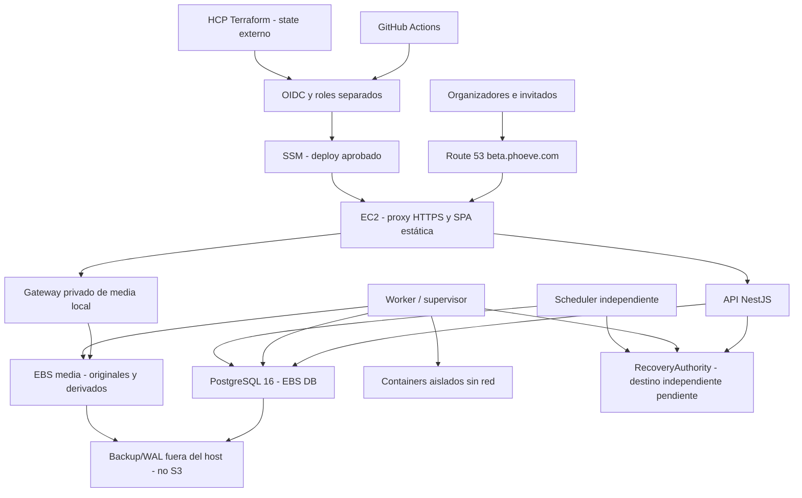

# Phoeve Beta — Propuesta de infraestructura y despliegue

Resolución parcial 2026-10-15 (DEC-113): S3 backups y filesystem/EBS operativo aprobados; autoridad y RPO no aprobados. [Continuación y condiciones de cierre](aws-beta-ticket-closure-plan.md). Prevalece sobre los destinos pendientes descritos en el historial de abajo; sin autorización de aprovisionamiento.

Actualización para revisión: [evaluación EL-TK-245 / CR-011](aws-beta-technical-evaluation.md) y [ADR propuesto](adr/beta-backups-and-recovery-authority.proposed.md). us-east-1 y dos eventos simultáneos ahora CONFIRMED; S3 backups/autoridad son alternativas evaluadas, no adoptadas. Usar los escenarios del informe para costos actuales. El resto conserva el historial de la propuesta; no habilita despliegue.

Fecha: 2026-10-14. RECOMMENDED; REQUIREMENTS_READY: NO; READY_FOR_IMPLEMENTATION: NO.
Todos los pasos de aprovisionamiento son futuros y requieren gates/aprobación. No hay archivos Terraform ni workflows ejecutables nuevos en esta entrega.

Revisión tras EL-TK-265: **NO-GO para desplegar la Beta funcional con datos reales**. Se puede preparar el laboratorio y cerrar decisiones sin crear AWS. La transferencia privada ahora existe en development, pero el proveedor filesystem Beta, aceptación/publicación, autoridad vigente y recuperación continúan pendientes. No cambiar a `NODE_ENV=development` en EC2 para eludir esas dependencias.

## Arquitectura

Una EC2 de aplicación, PostgreSQL y media local con volúmenes EBS separados. Autoridad/backups externos son control de recuperación, no otra aplicación Phoeve. Su servicio/proveedor/costo necesita aprobación. Sin ALB, NAT Gateway, ECS, RDS o bucket S3 obligatorio. EBS snapshots usan internamente almacenamiento AWS; no requieren integrar bucket S3 del proyecto. [Snapshots EBS](https://docs.aws.amazon.com/ebs/latest/userguide/ebs-creating-snapshot.html).

Red: VPC/subnet pública/IGW y EIP de aplicación; sólo TCP 80/443 inbound. 80 para challenge HTTP-01 y redirect, ningún API/PG/MinIO público. SSM para administración sin SSH público. Redes Docker privadas separadas; no asumir que `internal: true` deja salida para correo/authority. Diseñar rutas de egress controladas por servicio. IMDSv2, bloqueo IMDS desde contenedores no autorizados, sin AWS credentials en parsers. Salida HTTPS para SSM/registry/ACME/autoridad; salida de backup limitada al destino aprobado. [SSM](https://docs.aws.amazon.com/systems-manager/latest/userguide/session-manager.html), [ACME](https://letsencrypt.org/docs/challenge-types/).

## Módulos Terraform propuestos

Nombres semánticos: `infra/terraform/modules/{network,identity,compute,persistent-storage,dns,monitoring,snapshot-policy}` y roots `environments/beta` y `bootstrap`. Módulo de repositorio/ledger externo sólo tras decisión, no dependencia S3 implícita.

| Módulo | Responsabilidad / seguridad |
|---|---|
| network | VPC, subnet, route/IGW, SG sólo 80/443; egress y DNS explícitos; ningún 5432/3000/4200/9000 publicado. |
| identity | OIDC GitHub y HCP, roles plan/apply/deploy/instance separados, permissions boundaries, PassRole exacto, policies por ARN/tag y denegación de ampliación de privilegios. |
| compute | AMI arquitectura aprobada, EC2/EIP, IMDSv2, SSM, bootstrap idempotente sin secretos, root reemplazable; no destroy automático de datos. |
| persistent-storage | EBS cifrado DB/media/journal separado, attachments, identificación UUID estable, no formatear disco existente; prevent_destroy y retención fuera de vida EC2. |
| dns | Usar hosted zone aprobada/importada; A beta hacia EIP, no gestionar apex ni NS del dominio sin autorización. |
| monitoring | métricas/logs/alarms/SNS, retención y presupuesto, falta de heartbeat, alertas fuera del host. |
| snapshot-policy | DLM/AWS Backup según decisión, retención/tag/restore; DB/media separadas de authority. Nunca rollback conjunto de journal. |

Backend remoto **RECOMMENDED HCP Terraform**: cifrado/state history/locking, organización y workspace Beta separados, auto-apply desactivado, acceso MFA y mínimo, backups/export controlado del state. No state en git ni artifacts públicos. El plan oficial consultado ofrece Free hasta 500 managed resources; verificar elegibilidad/precio de la cuenta al adoptar, sin prometer cero costo indefinido. [HCP planes](https://developer.hashicorp.com/terraform/cloud-docs/overview), [remote state](https://developer.hashicorp.com/terraform/language/state/remote).

Recomendación de ejecución: GitHub Actions valida y presenta plan; HCP remote run realiza plan/apply con sus propias credenciales AWS OIDC. **GitHub OIDC no se hereda dentro del runner HCP**. Dos trusts separados: GitHub `aud=sts.amazonaws.com`, `sub=repo:OWNER/REPO:environment:beta-deploy` o branch exacta para plan; HCP `aud/sub` de organización/proyecto/workspace/fase exactos. Dos roles HCP PLAN/APPLY. GitHub usa token HCP de alcance mínimo para solicitar run, no claves AWS largas. Bootstrap inicial de IdPs/roles/state por operador autorizado; Terraform no puede crear su propio acceso de cero sin ese bootstrap. [HCP AWS OIDC](https://developer.hashicorp.com/terraform/cloud-docs/dynamic-provider-credentials/aws-configuration), [AWS trust GitHub](https://docs.aws.amazon.com/IAM/latest/UserGuide/id_roles_create_for-idp_oidc.html).

Plan no lee secrets; permisos read de infraestructura objetivo. Apply sólo recursos Beta/tag/zone permitidos, excepción de wildcard documentada para APIs Create/Describe que lo exijan. Deploy no crea infra ni modifica IAM/DNS/snapshots: SSM SendCommand a instancia tag Beta y documento acotado al digest firmado/aprobado, sin shell arbitrario del payload. SSM/host management sigue sendo poder administrativo y requiere auditoría. Instance role sólo parámetros específicos/logs/SSM y ledger si se aprueba. Backups y restore con roles separados; runtime no puede borrar repositorio completo. Acciones fijadas por commit SHA.

## Diseño Compose Beta

Especificación a implementar tras gates; no presentar servicios futuros como existentes:

| Servicio | Imagen/comando | Persistencia y acceso |
|---|---|---|
| edge | Proxy estático de SPA producción + ACME (Caddy candidato) | publica 80/443, certs/ACME persistentes; fallback SPA para /g; /api proxy; no directorio media público. |
| api | imagen Node mínima de release, main existente | DB/control network; authority configurada; no socket Docker; no LOCAL_ADMIN de desarrollo. |
| postgres | PG16 fijado con soporte backup integrado | `/srv/phoeve/postgres` EBS; sin `ports`; roles dedicados, TLS SQL según contrato; healthcheck. |
| migrate | comando actual de migraciones, one-shot | rol migrator temporal; backup compatible previo; no root data ni journal. |
| media-gateway | runtime nuevo, pendiente de implementación | EBS media, grants temporales y checks por request, sin URL pública al filesystem; subida stream/chunks acotados. |
| worker | runtime nuevo sobre componentes existentes | DB, media/control y supervisor restringido; scratch acotado; deja de claim al drenar. |
| scheduler | runtime nuevo | lock/lease singleton PostgreSQL y hora UTC; catch-up idempotente, heartbeat. |
| backup | pgBackRest y restic candidatos | SQL/data acceso mínimo, destino exterior cifrado; no datos efímeros como única copia. |

No desplegar perfiles dev tools/e2e/local-admin/contracts ni MinIO en Beta de filesystem sin S3. El Compose local se conserva para validación de contratos históricos. Build sin compilador/tests en runtime. Configuración de producción: `WEB_ORIGIN=PUBLIC_ENTRY_BASE_URL=https://beta.phoeve.com`, NODE_ENV=production, localhost-only exceptions deshabilitadas. Validar cookies Secure/HttpOnly/SameSite y CSRF con proxy real, IP cliente confiable para rate-limit y redacción de URL/capacidades en proxy. OpenAPI/docs de operación no expuestos sin decisión. Renovación ACME con ensayo staging y alerta caducidad; certificados y claves fuera de git.

**Delta de transferencia:** la implementación local nueva usa `PresignUploadService`/`LocalMediaStorage` con SDK MinIO, staging privado y versioning. `LOCAL_MEDIA_UPLOAD_ENABLED=true` se rechaza en production; si está deshabilitado, presign/confirm devuelven 503. EL-TK-251 debe introducir el adapter/config Beta y conectarlo al dominio existente, conservando el contrato same-origin de transferencia, la propiedad por guest y el receipt `local_upload_transfer`. El edge Beta reemplaza el proxy Angular `/storage` sin habilitar GET/listado público ni exponer `/srv/phoeve/media`. Si cambia el protocolo visible, verificar el gate UI sobre la experiencia de EL-TK-265.

El receipt `CONFIRMING` significa «Transferido; validación pendiente»: no crea media/job, no liquida la reserva ni ejecuta el pipeline. El smoke de despliegue debe verificar recepción → aceptación bajo autoridad real → validación → publicación/galería autorizada; un POST exitoso y readiness 200 no bastan para abrir la Beta funcional.

Mount EBS por UUID, permisos del UID real, systemd RequiresMountsFor y marcador de volumen obligatorio: si falta disco, impedir startup; nunca crear directorio vacío equivalente. DB/media/journal no se escriben en root Docker. Datos persisten tras recreate de contenedores/EC2; nunca `compose down -v` en release. Readonly root, tmpfs acotado, no-new-privileges/cap-drop donde compatible. API sin mounts de originales innecesarios. Parser sin salida/socket/credenciales y límites preservados. Docker runtime privilegiado sólo en supervisor y no como montaje universal.

## Recuperación y retención

Contratos preservados: base backup **full diario**, WAL continuo, horizonte mínimo 7 días, RPO DB ≤1 h, RTO servicio ≤4 h, copias protegidas fuera del host. Backups/versiones técnicas respetan máximo 30 días desde el ancla de purga vigente; papelera y ventanas de eliminación no se reinterpretan como retención de backup. Logs 30 días/auditoría 12 meses configurables conforme policy. [Contrato repo](../.codex/context/operations-and-recovery.md), [PITR PostgreSQL16](https://www.postgresql.org/docs/16/continuous-archiving.html).

**RECOMMENDED DB:** pgBackRest con repo externo cifrado y full diario/WAL archive; `archive_timeout` y alerta lag con margen antes de 1 h, test completo sin WAL perdido. `archive_command` no debe declarar éxito antes de copia durable exterior; volumen spool acotado, alerta caída repo y disco/WAL. Retención debe preservar cadenas válidas para todo el horizonte, no sólo borrar por nombre/fecha. Proteger repo de runtime; validar versión/ARM64 en imagen PG. [pgBackRest](https://pgbackrest.org/user-guide.html).

**RECOMMENDED media:** restic cifrado a SFTP/host externo, manifests de objetos inmutables/checksums, staging/scratch transitorios excluidos y derivados regenerables identificados. Un sello recibido todavía CONFIRMING no se descarta como staging por no estar publicado: decidir explícitamente su protección y RPO. El inventario debe enlazar attempt/receipt/objeto/versión/hash/bytes con los archivos reales del adapter Beta. No copiar el layout interno MinIO ni tratar `sealed_key` como ruta filesystem intercambiable. Si se migra contenido local existente, exportar la versión exacta, verificar bytes/hash y registrar el mapping autorizado; no actualizar referencias SQL a mano como procedimiento normal. Frecuencia inicial ≤1 h es recomendación, no RPO multimedia ya aprobado: decidir objetivo y semántica de upload confirmado/copia exterior. Restore rechaza originales corruptos/Missing, nunca inventa bytes. Medir throughput/capacidad para RTO y costo por cohorte. [restic destinos](https://restic.readthedocs.io/en/stable/030_preparing_a_new_repo.html).

Snapshots EBS complementan recuperación de volumen, no reemplazan base backup/WAL ni PITR. Quiescence consistente, manifests DB/media y snapshots cifrados con retención/purge verificables. No incluir journal en restauración del conjunto histórico. Snapshot de authority no permite volver a un estado revocado anterior. Si el journal más reciente no es demostrable, mantener barrera y acceso cerrado; prohibido bootstrap automático, epoch ficticio o confiar en DB restaurada. Un ledger independiente también necesita protección de permisos contra rollback/delete, consistencia, idempotencia y disponibilidad; nombrar DynamoDB no prueba el protocolo. El historial debe cubrir el horizonte de restore más margen; los floors vigentes y el ancla de actualidad no se eliminan por una TTL de siete días. Compactar sólo con checkpoint acreditado y sin reducir restricciones actuales.

Restore futuro: declarar incidente y barrera exterior → detener writers/leases → reconstruir EC2/mounts aislados → PITR DB y restore media con checksums → obtener autoridad actual con prueba independiente de monotonicidad → reconciliar restricciones, revocaciones, purgas/tombstones → avanzar epoch e invalidar grants/sesiones/leases antiguos → recuperar sólo jobs vigentes idempotentes → pruebas permisos/upload/gallery/download/delete → liberar únicamente scopes acreditados. Journal/keys de recuperación conservados fuera del timeline SQL. No reejecutar emails/exports históricos a ciegas.

## Estimación de costos

**ASSUMED:** us-east-1, Linux On-Demand, 730 h/mes, un IPv4, gp3 sin IOPS adicionales, uso cerrado pequeño. No incluye impuestos/dominio, créditos promocionales ni descuentos por compromiso. Referencia t4g.medium US$0.0336/h de [material AWS](https://d1.awsstatic.com/events/Summits/nysummit24/MIG202-S_Dynatrace_MigrateModernize_E4_NYSummit_20240710.pdf); no precio contractual vigente de región seleccionada. Actualizar cotización antes de apply. EBS/IPv4/Route53 verificados en páginas oficiales; uso snapshots/logs estimado.

| Concepto | USD/mes indicativo |
|---|---:|
| EC2 t4g.medium: 730 × 0.0336 | 24.53 |
| EBS gp3 104 GiB × 0.08 | 8.32 |
| IPv4 730 × 0.005 | 3.65 |
| Hosted zone Route53 (si nueva) | 0.50 |
| Snapshots: supuesto 40 GB retenidos × 0.05 | 2.00 |
| DNS queries + logs/alarms, asignación inicial | 1–3 |
| HCP Free si cuenta elegible | 0 |
| **Subtotal aplicación, sin recuperación exterior** | **40–42** |
| Repositorio externo backups: provisión de presupuesto pendiente | 10–20+ |
| Ledger independiente, asignación tentativa; depende diseño/uso | 1–3+ |
| **Total de planificación con controles completos** | **51–65+** |

[EBS](https://aws.amazon.com/ebs/pricing/), [IPv4](https://aws.amazon.com/vpc/pricing/), [DNS](https://aws.amazon.com/route53/pricing/). Los US$10–20/1–3 son reservas, no ofertas verificadas de proveedor. Cotizar repositorio según full diario/WAL, media y retención real. Un host backup adicional o SFTP contratado requiere autorización, no queda creado ni elegido.

Revisión de la estimación: se mantienen **US$40–42 para el núcleo y US$51–65+ con provisiones exteriores**, no una cotización aprobada. AWS sigue publicando IPv4 US$0.005/h y hosted zone US$0.50/mes para las primeras 25; la página EBS usa US$0.08/GB-mes como ejemplo de una región, no como precio universal. La referencia EC2 de US$0.0336/h continúa siendo ASSUMED hasta consultar el SKU/región/tenancy/OS exactos en Pricing Calculator/catálogo vigente; la consulta al endpoint público de catálogo intentada en esta revisión devolvió 404 y no se sustituyó por un precio de terceros. [EC2](https://aws.amazon.com/ec2/pricing/on-demand/), [VPC](https://aws.amazon.com/vpc/pricing/), [Route 53](https://aws.amazon.com/route53/pricing/).

Los 60 GiB de media del escenario no son un cupo vendible. Dimensionar `originales retenidos + staging concurrente + sellos/versiones huérfanos + derivados + exports + scratch por slot + margen operativo`. El sellado local actual puede coexistir con staging y versiones anteriores; el proveedor filesystem debe medir su pico real. No asumir que la cuota lógica o la liberación de una reserva equivale a bytes físicos liberados. Capacidad, egress, backlog de cleanup y lag de backups entran en el gate de admisión de cargas y en las alarmas antes de agotar el disco.

HCP Free sigue documentando hasta 500 recursos administrados; comprobar el plan/capacidades efectivamente habilitados. Las fuentes oficiales consultadas no son uniformes respecto a funciones avanzadas del nivel Free (blog y tabla de planes difieren), por lo que no presupuestar policy enforcement, custom RBAC o auditoría como incluidos sin acreditarlos. Para el mínimo propuesto basta demostrar state remoto con locking, permisos, run manual aprobado y OIDC separado; GitHub required reviewers en repos privados continúa condicionado al plan. [Planes HCP](https://docs.hashicorp.com/terraform/cloud-docs/overview), [anuncio HCP Free](https://www.hashicorp.com/en/blog/continuing-hcp-terraform-s-enhanced-free-tier-experience), [GitHub approvals](https://docs.github.com/en/actions/reference/workflows-and-actions/deployments-and-environments).

Egress no incluido: AWS publica 100 GB/mes agregados gratis para regiones elegibles; se comparte con otros servicios de la cuenta. Descargas/exports pueden superar esa cantidad rápidamente. Registrar precio regional excedente, volumen y presupuesto. T4g Unlimited cobra surplus CPU (AWS publica US$0.04/vCPU-h Linux), además de EC2: no prometer costo fijo bajo transcodes sostenidos. [AWS On-Demand](https://aws.amazon.com/ec2/pricing/on-demand/). GitHub Actions/registry, SMTP, KMS, retenidos snapshots y crecimiento media pueden sumar costo.

El objetivo US$35–50 parece posible para el núcleo, **no está demostrado para Beta recuperable completa**. Opciones a aprobar: reutilizar repositorio externo ya disponible/acreditado, reducir cohorte/retención sólo dentro de contratos vigentes, o ampliar presupuesto. No omitir PITR/journal para hacer cuadrar la cifra.

## GitHub Actions y orden de despliegue

CI PR: install frozen, builds/typechecks, OpenAPI/client check, tests unit y PostgreSQL real aislado, web/E2E críticos, secret scan, imagen/SBOM/dependency scan; PR de fork sin credenciales y sin workflows pull_request_target ejecutando código no confiable. CI ARM64 nativa para multimedia/digests. Publicación por digest desde revisión protegida; no recompilar en host.

Terraform PR: fmt/validate/tflint/policy y plan redacted, state lock remoto, rol plan limitado, sin secrets de aplicación. No apply PR. Apply futuro: aprobación de plan exacto/commit/config, run autorizado HCP con auto-apply off, permisos apply sólo después de gate, invalidar aprobación si cambia el plan. GitHub environments required reviewers depende plan/visibilidad: Free/Pro/Team sólo public según documentación; confirmar soporte antes de prometer gate en repo privado. Alternativa gate HCP con actor habilitado o plan GitHub elegible, nunca un workflow_dispatch sin validación de aprobador como sustituto. [GitHub approvals](https://docs.github.com/en/actions/reference/workflows-and-actions/deployments-and-environments).

Deploy aplicación separado de infra: environment Beta, concurrency serial sin cancelación abrupta, OIDC deploy, comprobación digest/release aprobado, backup vigente, mounts/authority saludables → drenar worker/scheduler → migración compatible one-shot → actualizar servicios → readiness/end-to-end → reanudar claims. Rollback sólo imagen/config compatible; nunca DB/journal/EBS histórico automático. Migraciones destructivas y downgrade necesitan procedimiento específico y aprobación.

Secuencia futura:

1. Cerrar CR-011/ADR, proveedores, región, costos, gate de aprobación y owner operativo.
2. Acreditar ARM64/capacidad y artefactos; implementar adapters/runtime en laboratorio aislado.
3. Preparar roots/módulos Terraform y policies; bootstrap state/OIDC con operador autorizado.
4. Revisar plan exacto; solicitar aprobación explícita antes de cualquier apply.
5. Crear red/EC2/EBS según plan aprobado; mount markers, IAM/SSM/secrets; sin datos reales aún.
6. Configurar autoridad exterior y backups; obtener evidencia de persistencia independiente.
7. Desplegar imágenes/Compose, migraciones, provisionamiento admin autorizado sin modo LOCAL_ADMIN.
8. Configurar registro Beta sobre zona aprobada, TLS/renewal; no modificar apex.
9. Ensayar CPU/storage/carga y outage/restore completo con barrera y revocación posterior al punto PITR.
10. Validar RPO/RTO, purgas/copias≤30d, alertas y deny matrix; aprobación de apertura cerrada y rollback operativo.

No avanzar a datos reales mientras el ensayo DR/autoridad sea PENDING. Tickets ordenados: [EL-EP-020](../.codex/product/epics/EL-EP-020.md).

## Decisiones y orden revisado para desbloquear trabajo

| Gate | Decisión/evidencia pendiente | Seguimiento |
|---|---|---|
| Producto y operación | Región/AZ, control de zona/DNS, cohorte y volumen, RPO multimedia, presupuesto completo, responsable operativo y destino de alertas | EL-TK-245 |
| Contrato filesystem Beta | Adoptar sustitución técnica focal ya solicitada a nivel producto, puerto neutral y garantías de identidad/versión/grants/drain; no elegir de nuevo MinIO como producción por conveniencia | 245 → 251 |
| Autoridad y DR | Destino externo actual/monotónico, coordinación de writers, wiring admin/organizer/jobs, decisión DEC-112 reconciliada y prueba PostgreSQL/WAL real post-revocación | 245 → 252 → 262 |
| Capacidad | ARM64 nativo de todos los artefactos, carga con hash/sellado/scanner/codecs y modo de créditos CPU; dimensionamiento físico con margen | 246,255 |
| Recuperación | Proveedor/capacidad externa sin S3, full diario/WAL continuo, inventario exacto de media y retención/purga verificable | 257,258 |
| Publicación | Receipt CONFIRMING → aceptación/validación/worker → galería/grants autorizados; scheduler integrado y cleanup operativo | 251,252,253,254 |
| Entrega | HCP/state y OIDC, aprobación efectiva para repo/plan elegido, imágenes y edge production/TLS, CI/CD y ensayo de rollback de aplicación | 247,255,256,259,260 |

Siguiente trabajo recomendado: resolver EL-TK-245 y preparar evidencia acotada de capacidad/proveedor en laboratorio; no empezar por `terraform apply`. Una vez aprobados los gates de cada ticket, pueden implementarse en paralelo los ámbitos independientes de storage, autoridad y cadena de entrega. Mantener DRAFT los tickets no preparados; el DONE focal de 265 no certifica Beta.

Validación de esta actualización: arquitectura independiente mantiene NO-GO para despliegue; requirements_reviewer aprueba la calidad documental después de explicitar 258 → 252 y distinguir los gates históricos. Verificados los 18 tickets contra la tabla de épica: dependencias coincidentes y orden acíclico. `git diff --check` PASS. No se ejecutaron pruebas de aplicación, ARM64, PITR ni recursos cloud durante esta revisión documental; las evidencias de transferencia son las registradas en EL-TK-265.
