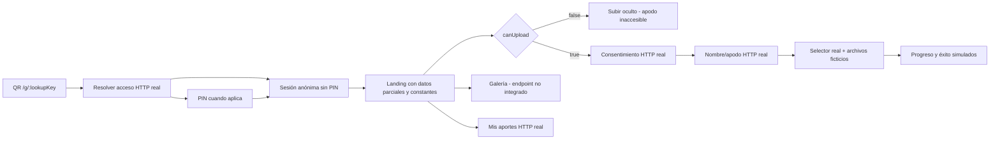

# Phoeve — Auditoría del recorrido invitado y gaps

Fecha: 2026-10-14. Alcance: análisis solicitado, sin cambiar aplicación, permisos ni datos de eventos.
Estado: CONFIRMED para hallazgos de fuente/pruebas indicados; propuestas RECOMMENDED, decisiones y pruebas pendientes explícitas.

## Resultado principal

El recorrido tiene entrada/sesión/PIN/consentimiento/apodo conectados a HTTP real, pero conserva pantallas de maqueta en información y carga. No está acreditado el recorrido completo foto real → persistencia → procesamiento → galería → Mis aportes → retiro. La captura coincide con la landing implementada: fecha/ciudad fijas, ausencia de opción Subir en el menú y CTA oculto cuando canUpload es falso.

No se consultó el evento real de la captura ni se modificó su estado. Por eso su causa operacional exacta (estado/cargas/configuración) permanece PENDING. No afirmar que activarlo o habilitar cargas resuelve la carga: después de esos permisos, el código todavía simula la transferencia.

## Qué explica los tres problemas reportados

1. **Información del evento:** el nombre usa la respuesta de acceso, pero tiene fallback falso «Cumpleaños de Néstor». La fecha «17 de octubre · 6:00 p.m.», «Barranquilla» y la imagen de celebración son constantes de la plantilla. El DTO público no transporta fecha programada, mensaje de bienvenida ni portada configurada; el dominio sí contiene startsAtLocal/scheduledAt/welcomeMessage/coverAssetId. No se encontró ubicación en ese EventRecord: no inventarla ni prometerla sin definir su ownership/configuración.
2. **Nombre/apodo:** hay formulario y POST real de nickname. No existe registro de cuenta guest: se emite sesión anónima HttpOnly automáticamente en evento ALLOWED sin PIN. Consentimiento y apodo se solicitan al iniciar la primera carga, no al abrir el enlace. En la landing actual ese inicio depende del CTA Subir; si está oculto, tampoco se llega al apodo. Si la sesión ya tiene apodo/consentimiento, se omiten correctamente; esto debe ser comprensible en UI.
3. **Subir desde menú:** el menú sólo tiene Galería, Políticas de carga y Solicitar retiro. El botón principal Subir existe bajo `@if (canUpload)`; no se muestra una acción deshabilitada con explicación. En ACTIVE con uploadsEnabled=false, el resolver devuelve ALLOWED pero omite restrictionReason, aunque la política deniega cargas. Esto permite una pantalla con sesión, cero aportes y ninguna explicación de cómo participar.

## Mapa real del flujo

El diagrama describe código actual, no arquitectura deseada. PIN/autorización no equivalen a consentimiento, identidad de presentación ni carga confirmada.

## Matriz de gaps verificados

Prioridad P0: impide acreditar integridad/éxito de participación. P1: bloquea o confunde una función principal. P2: calidad/robustez. No son tickets READY ni estimaciones.

| ID | Prioridad | Gap / evidencia | Comportamiento recomendado y aceptación |
|---|---|---|---|
| G-01 | P1 | Landing inventa fecha/ciudad/portada y nombre fallback. `guest-container.component.ts:143–172`; DTO público omite metadata. | Proyectar datos permitidos del evento real, formatear fecha en TZ del evento y usar fallback neutro. Dos eventos con nombres/horarios distintos muestran sus datos; campos ausentes no muestran ejemplos ficticios. |
| G-02 | P1 | Menú no tiene Subir; CTA desaparece si canUpload=false. Plantilla :119–129/:203. | Subir fotos y videos en menú y CTA principal. Si denegado, opción/estado visible con explicación, sin iniciar una carga ni alterar permisos. Galería y Mis aportes con disponibilidad independiente. |
| G-03 | P1 | Resolver ACTIVE fuerza ALLOWED sin explicar uploadsDisabled; política sí devuelve motivo. `event-public-access.ts:342`, `access-policy.ts:134–165`. | Capacidad granular y motivo/código para cargas y galería, separado de acceso a landing. Mensajes español: aún no inicia, cargas deshabilitadas, cerrado, cuota alcanzada, sesión inválida. Nunca imprimir directamente diagnósticos internos en inglés. |
| G-04 | P1 | Apodo sólo alcanzable desde startUploadFlow; barra muestra Invitado para nickname null. :2224–2243. | Recorrido claro de primera participación: sesión válida → consentimiento requerido → nombre/apodo → selección. Menú o barra puede permitir completar/cambiar apodo; reentrada conserva sesión vigente. No añadir cuenta/email obligatorio. |
| G-05 | P0 | initializeDefaultMockFilesIfEmpty agrega cuatro archivos inventados sin File; varias entradas lo llaman. :2297–2341. | Selección vacía inicialmente; sólo archivos elegidos por usuario. Ningún mock puede llegar al flujo real ni mostrarse como aporte. |
| G-06 | P0 | startUploadingSelectedFiles y retryFileUpload sólo cambian señales/timers; no envían bytes. :2387–2441. | Autorizar intento/capacidad → transferir bytes → confirmar checksum/tamaño → procesar → estado autoritativo. Éxito sólo tras receipt real; retry con misma intención, duplicados/outage sin falsas confirmaciones. |
| G-07 | P0 | confirmedPhotosCount/confirmedVideosCount fuerzan mínimos 3/1 y cuentan contribuciones sin filtrar recepción efectiva. :2111–2120. | Conteos del lote/receipts reales, separar transferido/procesando/publicado/rechazado. Cero seleccionado/confirmado jamás presenta 3 fotos/1 video. |
| G-08 | P1 | Galería/view-grant/reporting llamados por GalleryService no están publicados en OpenAPI/AppModule. GET local /api/v1/gallery devuelve404. | Integrar adapters HTTP autorizados sobre dominio/storage; galería deshabilitada no se presenta como galería vacía ni error genérico. Fotos nuevas sólo aparecen tras processing/publicación vigente. |
| G-09 | P2 | Filtros Todo/Fotos/Videos sólo cambian activeGalleryFilter; no se pasan al componente/service. :751–779. | Filtrado real coherente con paginación y selección de viewer, no sólo estilo activo. |
| G-10 | P1 | Mis aportes GET existe, pero transferencia simulada no produce aportes; refreshContributions no se llama al completar/abrir la bandeja. :259/:2457. | Consultar colección propietaria tras receipt y al abrir; estados/reintentos por aporte y vacío verdadero. No recuperar sesión por apodo ni mostrar aportes de otro evento/sesión. |
| G-11 | P1 | Lista emite requestRemoval sin item y se conecta al intake general; openOwnRemovalFlow no tiene acción por aporte. Retiro propio requiere token JS ausente en sesión HttpOnly; rutas remove/intake POST no están integradas. | Separar retiro propio por mediaId de solicitud sin sesión. Auth mediante cookie real/CSRF y guard propietario; no exponer token al JS. Confirmación de solicitud no equivale a purga ejecutada. |
| G-12 | P1 | Consentimiento usa v1.0 fija, tres checks true por defecto y textos locales abreviados; no recibe versión vigente desde server. `consent-sheet.component.ts:511–519`, contenedor :306. | Consentimiento explícito sin selección previa, documentos/versiones autoritativos y aceptación persistida. Versión cambiada vuelve a solicitar aceptación conforme contrato; fallo no permite avanzar. No se emite dictamen jurídico sobre los textos. |
| G-13 | P2 | Identificación muestra «Correo o alias (opcional)», pero sólo emite nickname y no persiste ese campo. `guest-identity-form.component.ts:83/:399/:409`. | Eliminar campo no aprobado o definir propósito/contrato/minimización primero. No sugerir cuenta o recuperación por email inexistentes. |
| G-14 | P1 | Errores de sesión/consent se muestran en landing, pero failure de consent no vuelve a LANDING; currentStep CONSENT mantiene pantalla por OR. Acciones Subir más/start no revalidan capability actual. | Guard de pasos y reconciliación server ante expiración/revoke/cierre; error visible en pantalla actual, no doble submit ni continuación tras perder permiso. No convertir fallo de red en sesión definitivamente revocada. |
| G-15 | P1 | Selector trata todo no-video como PHOTO; duración local fija0:28; políticas de tamaño/formato estáticas. :2364–2381/:856. | Validación individual temprana con policy del evento y confirmación server real; fotos25MB/videos500MB/5min y formatos admitidos según contrato vigente/config. Archivo inválido no cancela otros; nunca asumir duración. |
| G-16 | P2 | URLs preview se crean sin liberar al quitar/destruir; timers sin cleanup; estados entre pasos pueden retener selección/modales. | Liberar object URLs y cancelar efectos UI al salir/cambiar evento; probar cambio de ruta y race de respuestas. El cruce real entre eventos aún requiere reproducción, no está declarado como incidente confirmado. |
| G-17 | P1 | Menú/modal de políticas no acredita foco, Escape/aria-expanded/focus-return; sólo handlers simples. | QA teclado/lector/320–375px, foco al cambiar de pantalla/error y controles44px; cierre de sheets/menú accesible. Verificar el comportamiento, no inferir conformidad desde CSS. |

## Flujo objetivo recomendado

1. QR/link válido → información auténtica del evento y estado visible. En SCHEDULED mostrar fecha/aviso sin habilitar cargas; en terminal/revocado error neutro. No login de organizador requerido.
2. PIN sólo si corresponde; sesión anónima autorizada. «Participando como Invitado» no equivale a registro completo; mostrar completar nombre cuando aplique.
3. Menú: información del evento, Subir fotos y videos, Galería, Mis aportes, políticas y solicitud de retiro. Disponibilidad regida por capacidades server y explicación; no habilitar por tener botón.
4. Primera carga: consentimiento vigente → nombre/apodo1–60 → selector vacío. Si ya cumplidos, selección directa. Cancelar conserva acceso permitido y no finge aceptación/carga.
5. Cámara/galería del celular → validación por archivo → intento real/transferencia → confirmación/processing/publicación. Conservar bytes originales; no convertir preview en original. Mobile formatos y permisos pueden variar, deben ensayarse.
6. Progreso individual/retry/errores reales; éxito y conteos sólo autoritativos. Mis aportes actualizado y separado de galería general/moderación.
7. Reentrada/logout cookie eliminada/revoke/cierre: conservar solamente lo permitido; Mis aportes en CLOSED/GRACE_PERIOD con sesión válida sigue DEC-084. Sin sesión, intake separado sin recuperar identidad por nickname/email.

## Dependencias y orden de corrección

**RECOMMENDED, no ejecución autorizada por este informe:**

1. Retirar datos/mock/éxitos inventados, corregir motivo de bloqueo y guard de pasos. UI_REQUIRED: YES, revisión de flujo/foco/estados antes de plan frontend.
2. Proyección pública segura de metadata y menú/CTA; aclarar el instante de captura del apodo. No introducir ubicación persistida sin decisión.
3. Cerrar gateway/storage y adapters HTTP reales de autorización/transferencia/confirmación, galería/view grants/retirada. El plan AWS CR-011/EL-TK-251 propone filesystem local pero está DRAFT: no sustituir silenciosamente DEC-063 ni usar LaboratoryStorage como producción.
4. Integrar worker/processing y comprobación de originales/grants. Luego conectar progreso/mis aportes/galería reales y reconciliación de restricciones.
5. Ejecutar E2E con PostgreSQL/storage/worker reales aislados, mobile y permisos; review focal y crítico si cambia seguridad/titularidad/antirollback. No rehacer backlog histórico ni llamar a todo «frontend terminado» por tickets DONE.

Las interfaces de dominio existentes ayudan, pero su presencia no acredita wiring HTTP. Preservar EL-EP-004/005/006 y EL-TK-075/076/077/078/083; seguimiento prospectivo de integración y regresiones, sin alterar sus estados durante esta auditoría.

## Pruebas y evidencia de esta revisión

- Grafo EventLens: búsquedas GuestContainer y cobertura de guest/gallery/API/domain; archivos sin tracking en índice2026-10-09, corroborados en fuente dirigida.
- `pnpm.cmd --filter @eventlens/web test --include src/app/guest/guest-container.component.spec.ts --include src/app/gallery/gallery.component.spec.ts --include src/app/guest/removal-request-flow.component.spec.ts`: **23/23 PASS**, tres archivos (7+7+9).
- Las pruebas de guest usan servicios mockeados; una verifica archivos preinsertados y navega manualmente a CONFIRMATION. No son prueba de transferencia/persistencia real ni de metadatos del evento.
- API local: GET `/api/v1/health/ready`200; GET `/api/v1/gallery?eventId=00000000-0000-0000-0000-000000000000`404. Sin generar guest sessions ni modificar datos reales.
- OpenAPI publica seis rutas guest: resolve, session/PIN, consent, nickname, own contributions, removal-intake GET. No contiene los endpoints gallery/upload/removal POST consumidos o necesarios para completar este recorrido; controllers registrados contrastados en AppModule.
- No se ejecutó prueba manual en los dos teléfonos ni inspección del evento real de la captura. No afirmar reproducción en dispositivos ni data loss real de fotografías previamente subidas.

## Entrega focal posterior — 2026-10-14

Esta sección registra el resultado implementado después de la auditoría; las observaciones y evidencias históricas anteriores describen el estado revisado originalmente y se conservan sin reescritura.

### Cambios aprobados

- El acceso público entrega `scheduledAtISO` y `welcomeMessage` únicamente cuando `canViewLanding` lo permite; los valores pueden ser `null`. No se añadieron ubicación ni portada. En ACTIVE con uploads deshabilitados se conserva ALLOWED y se informa el motivo de restricción.
- El menú presenta «Subir fotos y videos» de acuerdo con permisos. El invitado puede completar o editar su apodo en su sesión propia sin depender de iniciar una carga; no se pide correo. Los consentimientos comienzan sin marcar.
- La selección comienza vacía y sólo representa archivos escogidos por el invitado. Se retiraron archivos ficticios, mínimos artificiales de conteo y estados temporizados de progreso/éxito. La UI avisa que la transferencia no está disponible antes del onboarding y mantiene deshabilitada la acción «Cargar».
- Se mantuvo el contrato de sesión por cookie HTTP. Guardas de versión/contexto descartan respuestas asíncronas obsoletas, incluyendo recibos de sesión o respuestas 401 anteriores; destruir la vista A no cancela la petición de la vista B. También se liberan object URLs y el menú gestiona Escape y retorno de foco.

### Gaps cerrados y límites

G-02, G-05 y G-13 quedan cerrados dentro del alcance de esta entrega. G-01 queda parcial: fecha programada y bienvenida son datos reales sujetos a `canViewLanding`, pero ubicación y portada siguen sin proyectarse. G-03 queda parcial: se muestra la razón de restricción y se comunica que no hay transferencia disponible, mientras el transporte sigue sin integrar. G-04 queda parcial: onboarding y edición del apodo se pueden alcanzar de forma independiente de las cargas. G-06 sólo queda corregido en cuanto a retirar la simulación; no hay transferencia real. G-12 sólo cambia el estado inicial de los checks; no se definió una versión legal autoritativa. G-14/G-16 cubren guardas asíncronas y limpieza probadas. G-17 cubre el menú, sin QA integral de modales ni validación móvil en los dos teléfonos.

Siguen pendientes transferencia/gateway, galería real, retiro por aporte y versión vigente de políticas. Esta entrega no demuestra que las imágenes se guarden o publiquen.

### Evidencia de la entrega

- Web guest/gallery: 42/42; dominio: 12/12, incluido el fixture suspendido que oculta metadata no nula; guest-public-entry con PostgreSQL aislado: 1/1.
- Builds API/domain/client/web, generación OpenAPI, `client --check` y `git diff --check`: PASS. Reviewer aprobó tras corregir el hallazgo de carrera asíncrona.
- El build web mantiene una advertencia de presupuesto existente: 923.25 KB frente al umbral de advertencia de 600 KB, por debajo del umbral de error de 1 MB.
- `docker compose up --build -d --wait api web` terminó con exit code 0 y API/web quedaron Healthy; `http://localhost:3000/api/v1/health/ready` y `http://localhost:4200/` respondieron 200. No hubo migraciones ni cambios de volúmenes. La base aislada de la prueba se detuvo y se restauró al estado previo.
- No hubo prueba en los dos teléfonos; el PASS runtime local no demuestra transferencia real.

## Pendientes acotados

### Correctivo de permisos del organizador — EL-TK-264

El menú correcto es **Invitados y Aportes**. La tarjeta «Participación e invitados» antes sólo mostraba los valores; ahora permite editar **Permitir subir fotos y videos** y **Permitir ver la galería**, y guardar ambos mediante **Guardar permisos**. Son independientes y editables para el owner ordinario en DRAFT/SCHEDULED/ACTIVE. Prepararlos no activa el evento ni sustituye sus políticas.

El guardado usa CAS, receipt durable, Origin/CSRF y sesión scoped. Desactivar subidas cancela intentos sin confirmar y libera reservas en la misma transacción; conserva aportes VALIDATED/ACCEPTED y object keys. La consulta durante incertidumbre mantiene el intento exacto y no anuncia éxito por coincidencia de flags.

Evidencia: 42 pruebas frontend, 16 unitarias y 17 PostgreSQL aisladas PASS; builds y contrato PASS; revisión independiente APPROVED. Runtime local actualizado con API/web Healthy y HTTP 200. Bundle web 934.61 KB mantiene advertencia frente a 600 KB, bajo error de 1 MB. No QA manual en teléfonos.

Queda cerrada la ausencia de controles de permisos en el organizador. **La transferencia real de archivos, galería HTTP y cleanup físico siguen pendientes**; la pantalla lo comunica explícitamente. Trazabilidad: CR-012 y EL-TK-264.

- Estado/capacidades reales del evento de la captura: verificar respuesta del resolver y configuración organizer sin cambiar permisos durante diagnóstico.
- Momento del nombre/apodo: contrato actual antes del primer aporte; solicitarlo inmediatamente al entrar sería una decisión de UX adicional, no un bug de ausencia de cuenta.
- Campos públicos adicionales: ubicación/descripción/portada y ownership/configuración, sin divulgar información no aprobada.
- Contrato de versiones legales, gateway local, rutas HTTP y autorización de galería/retiro, sujetos a gates técnicos existentes.
- No se generaron nuevos tickets READY ni se implementaron cambios de aplicación como parte del análisis.

## Transferencia real implementada — EL-TK-265

La limitación de transporte descrita en las secciones históricas queda sustituida para el entorno local: selección y Cargar archivos explícito, autorización/reserva durable, POST real privado a MinIO, progreso XHR medido y confirmación idempotente. La identidad recibida conserva versión y SHA-256 observados; modificar staging después no altera el sello. La recepción técnica queda en CONFIRMING con «Transferido; validación pendiente», sin crear media/jobs ni afirmar publicación.

G-06 avanza a parcial: transporte y confirmación técnica operativos, pero aceptación/pipeline/publicación siguen pendientes. G-10 cubre refresh de Mis aportes y snapshot durable de CONFIRMING; no acredita galerías ni retiro. G-03 ya no necesita el aviso de transporte inexistente en el entorno local habilitado. G-08, políticas legales y limpieza física conservan sus pendientes. No cambiar estados históricos de aceptación por el simple envío de bytes.

Evidencia: 11 casos HTTP PostgreSQL/MinIO PASS; 18 regresiones PostgreSQL PASS; 44 unitarias API, 4 capacidad y 44 frontend focales PASS. Proxy Angular real PASS con Host alternativo, bytes idénticos, versión real y lecturas denegadas; proxy unitario 1/1. Builds y contrato PASS; revisión independiente APPROVED. API/web locales actualizadas Healthy y HTTP 200; bucket privado/versionado inicializado, volúmenes conservados, migración aditiva aplicada. Servicios aislados detenidos tras limpiar sus bases propias. No se probaron teléfonos físicos.

Guía de operación y límites: `docs/local-guest-uploads.md`. MinIO se habilita sólo en development; esta entrega no adopta almacenamiento S3 para Beta ni modifica recuperación/journal. Los huérfanos privados tras fallo/cancelación quedan pendientes de cleanup con drenaje demostrado.
